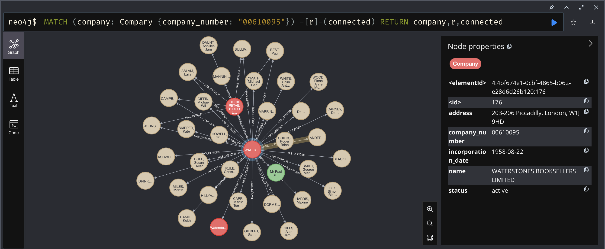

# companies-house-neo4j-python

A proof of concept CLI app that stores the full graph network (officers, persons with significant control) of a UK company in [Neo4j](https://neo4j.com) using the [Companies House Public Data API](https://developer-specs.company-information.service.gov.uk/companies-house-public-data-api/reference).


*Graph company data of [Waterstones Booksellers Limited (00610095)](https://find-and-update.company-information.service.gov.uk/company/00610095)*

## Getting Started

[mise](https://mise.jdx.dev/) manages the pinned toolchain (Python 3.15, uv).

```bash
# macOS / Linux
curl https://mise.run | sh

# Windows
winget install jdx.mise
```

Activate mise in your shell (`~/.zshrc`):

```zsh
eval "$(mise activate zsh)"
```

Then, in the repo:

```bash
mise trust         # one-time
mise install       # downloads Python and uv
mise run install   # installs dependencies into .venv
```

Create a `.env` file at the root of the project. Generate an API key using the [Companies House API guidelines](https://developer-specs.company-information.service.gov.uk/guides/authorisation).

```dotenv
COMPANIES_HOUSE_API_KEY="change_me"
COMPANIES_HOUSE_BASE_URL="https://api.company-information.service.gov.uk/"

NEO4J_URI="bolt://localhost:7687"
NEO4J_USER="neo4j"
NEO4J_PASSWORD="password"
```

Optionally run Neo4j as a container:

```bash
docker compose up -d neo4j
```

## Running

```bash
uv run python main.py <COMPANY_NUMBER>
```

Example — Waterstones Booksellers Limited:

```bash
uv run python main.py 00610095
```

## Development

| Command            | Description                                 |
|--------------------|---------------------------------------------|
| `mise run install` | Install dependencies into `.venv`           |
| `mise run test`    | Run tests                                   |
| `mise run fmt`     | Format code via `ruff format`               |
| `mise run lint`    | Lint code via `ruff check`                  |
| `mise run typecheck` | Type check via `ty check`                 |
| `mise run vuln`    | Scan dependencies for known vulnerabilities |
| `mise run deps`    | Update and sync dependencies                |
